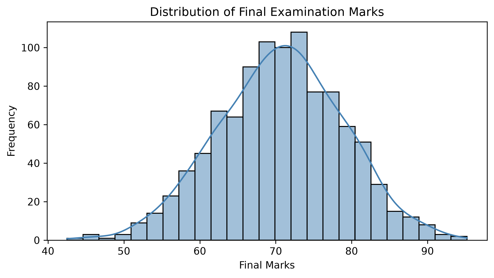
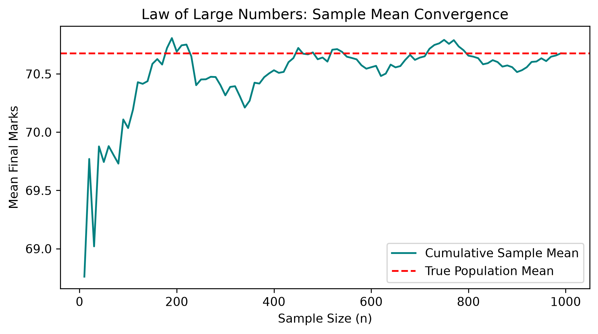
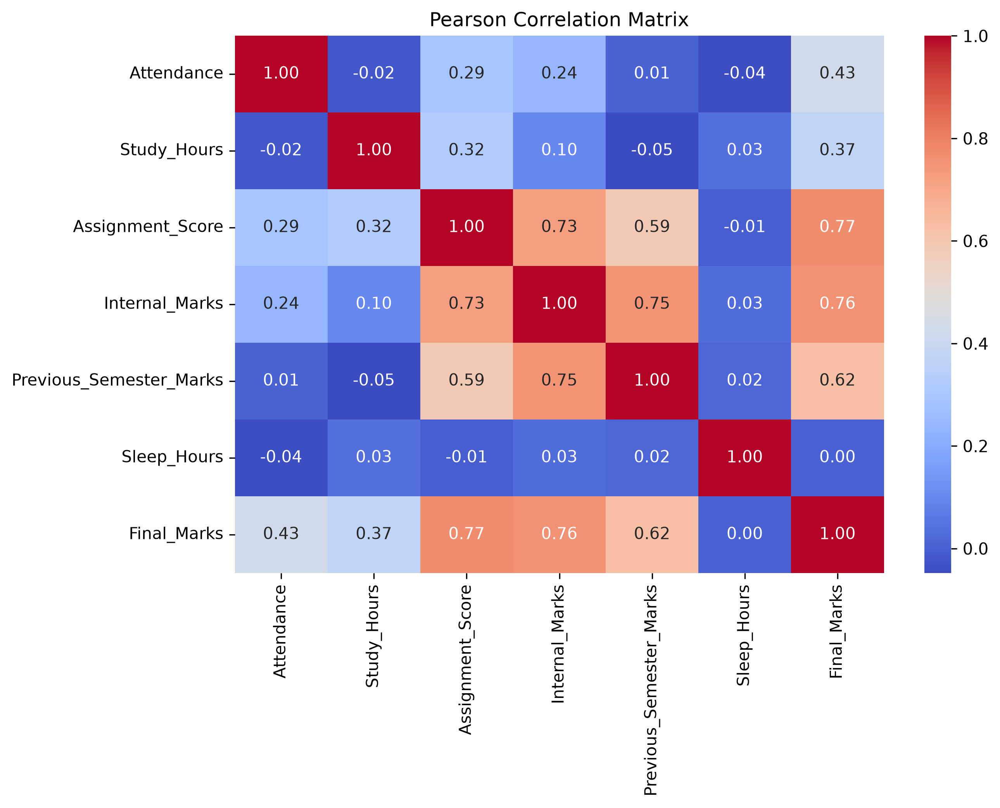
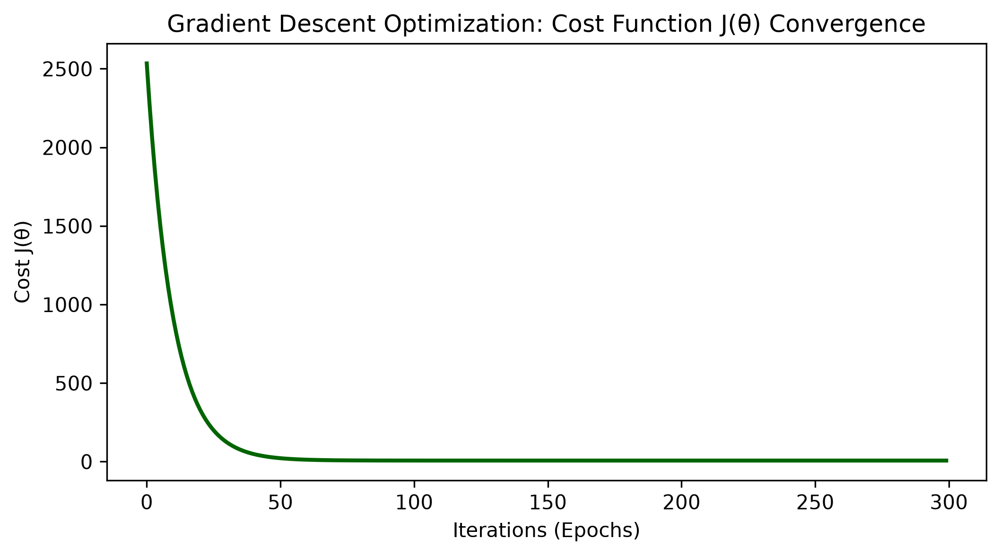
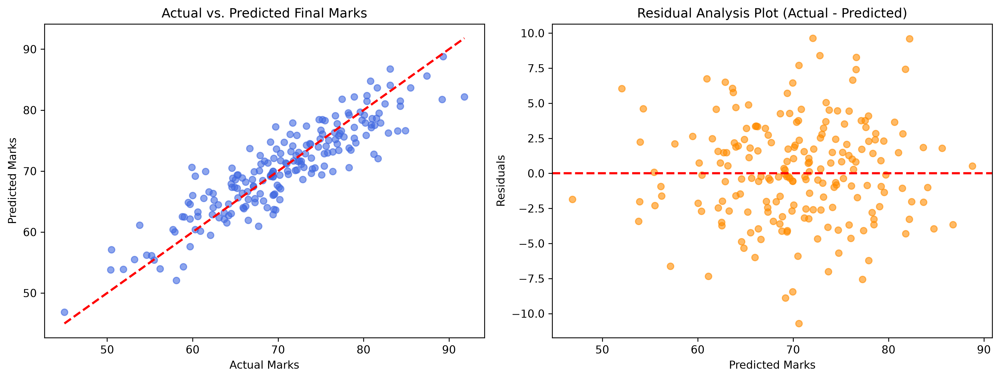

# Student Academic Performance Analysis and Prediction Using Statistical and Mathematical Techniques

## Project Objective

Analyze multiple academic and behavioral factors influencing student performance across **1,000 student records** and develop regression models using both statistical libraries (`scikit-learn`) and first-principles linear algebra and calculus (`NumPy`) to predict final examination marks.

## Repository Structure

- `dataset/student_performance_1000.csv` — 1,000-record dataset (1,010 raw rows before cleaning; 14,010 descriptive words across academic remarks)
- `notebooks/Student_Performance_Analysis.ipynb` — Complete executable Jupyter Notebook covering Tasks 1–8
- `plots/` — Saved high-resolution visualizations for distribution, probability convergence, correlation, gradient descent, and residuals

## Project Implementation Workflow (Tasks 1–8)

1. **Task 1 — Data Preprocessing:** Removed 10 duplicate records, imputed 15 missing numerical values using column medians, and classified numerical vs. categorical variables.
2. **Task 2 — Descriptive & Inferential Statistics:** Computed mean, median, mode, variance, and standard deviation; executed random, systematic, and stratified sampling; conducted an independent two-sample t-test comparing extracurricular participation groups.
3. **Task 3 — Probability Analysis:** Calculated $P(\text{Final Marks} > 80)$, conditional probability $P(\text{Marks} > 80 \mid \text{Attendance} > 75\%)$, Bayes' theorem, and demonstrated the Law of Large Numbers convergence.
4. **Task 4 — Correlation Analysis:** Generated Pearson and Spearman correlation matrices identifying `Internal_Marks`, `Previous_Semester_Marks`, and `Study_Hours` as the strongest predictors of final marks.
5. **Task 5 — Regression Analysis:** Developed and compared Simple Linear Regression (`Attendance` only) against Multiple Linear Regression (`Attendance`, `Study_Hours`, `Assignment_Score`, `Internal_Marks`, `Previous_Semester_Marks`).
6. **Task 6 — Linear Algebra (NumPy):** Implemented vector addition, dot products, and solved the Normal Equation $\theta = (X^T X)^{-1} X^T y$ analytically, matching `scikit-learn` weights.
7. **Task 7 — Calculus & Optimization:** Derived partial derivatives of the Mean Squared Error cost function $J(\theta)$ and implemented Batch Gradient Descent over 300 epochs.
8. **Task 8 — Model Evaluation & Residual Analysis:** Evaluated MAE, MSE, RMSE, and $R^2$; confirmed unbiased predictions (Mean Residual = `0.1502`; 100 overestimated vs. 100 underestimated test cases).

## Visual Results

### 1. Final Marks Distribution

### 2. Law of Large Numbers Convergence

### 3. Pearson Correlation Matrix

### 4. Gradient Descent Cost Function Convergence

### 5. Actual vs. Predicted Marks & Residual Analysis

## Team Members

| Member       | Name             | Register Number |
| :----------- | :--------------- | :-------------- |
| **Member 1** | Ahmed Shariff.A  | 311824102302    |
| **Member 2** | Mohamed Sahith   | 311824102039    |
| **Member 3** | Mohammed Riyaz   | 311824102045    |
| **Member 4** | Ahamed Shariff.K | 311824102006    |
